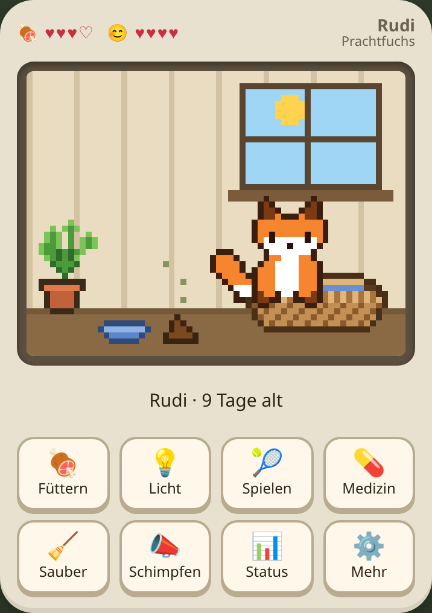
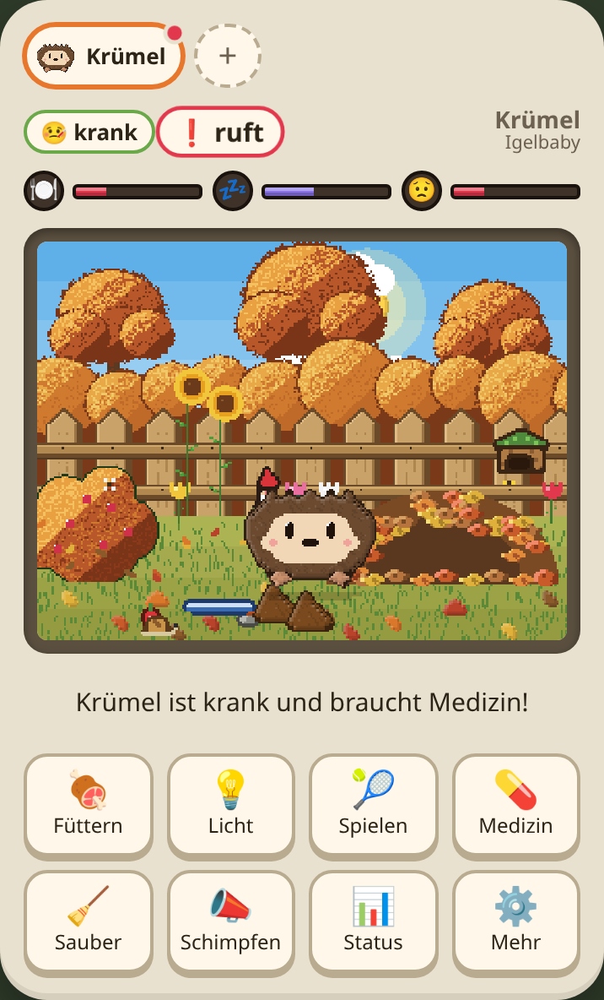
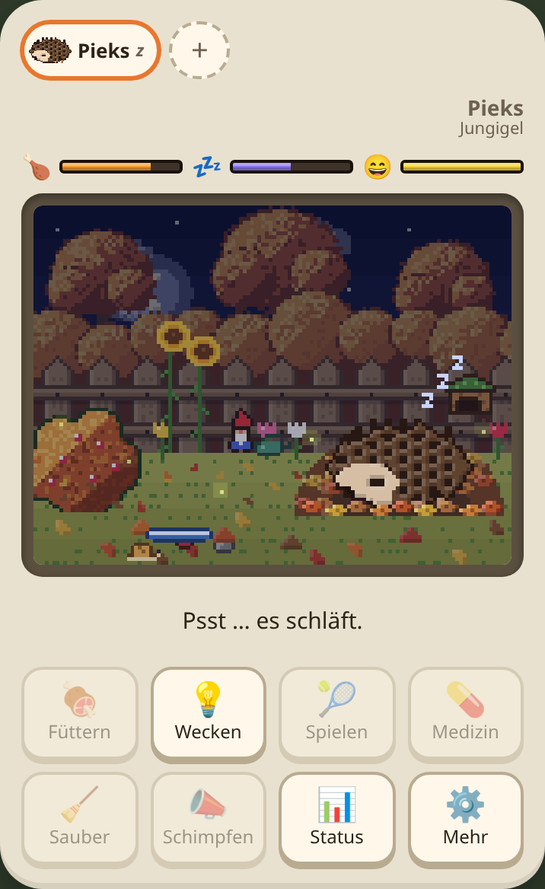
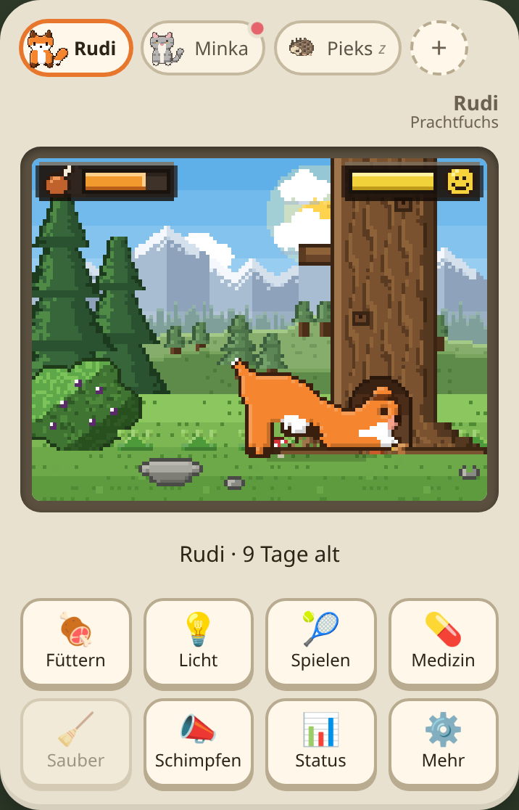
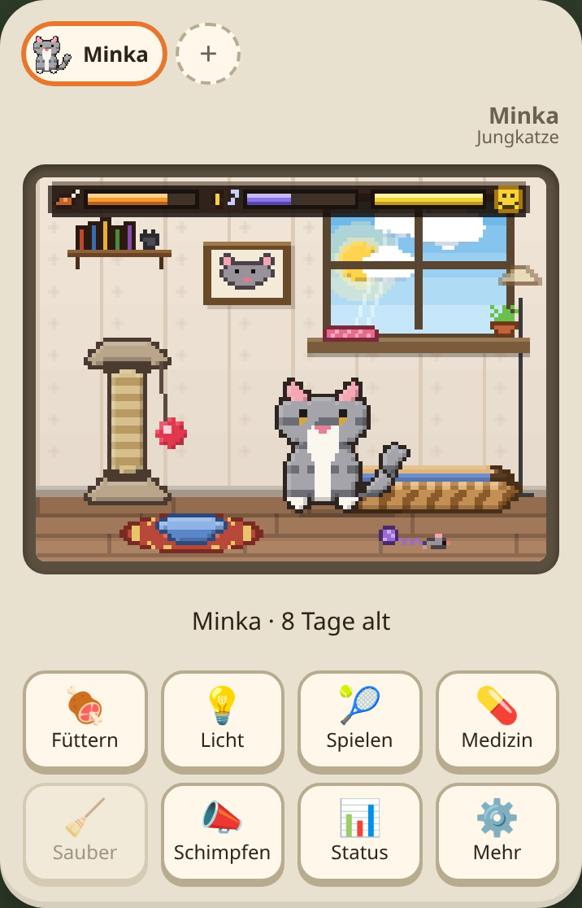
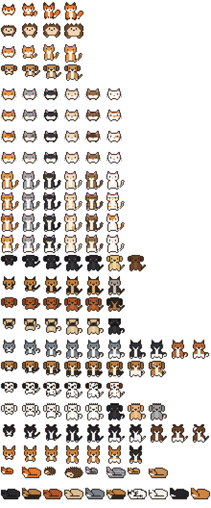
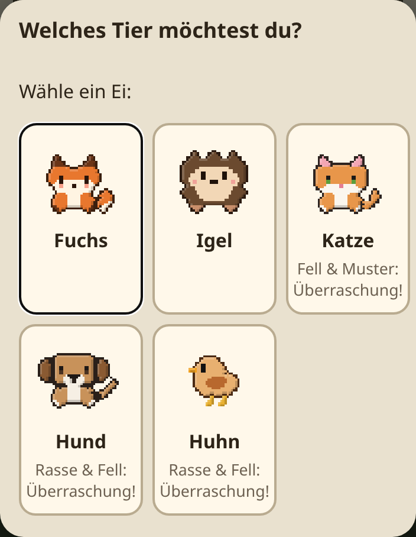
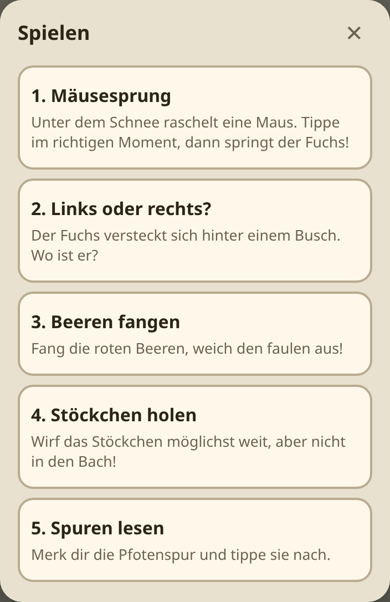
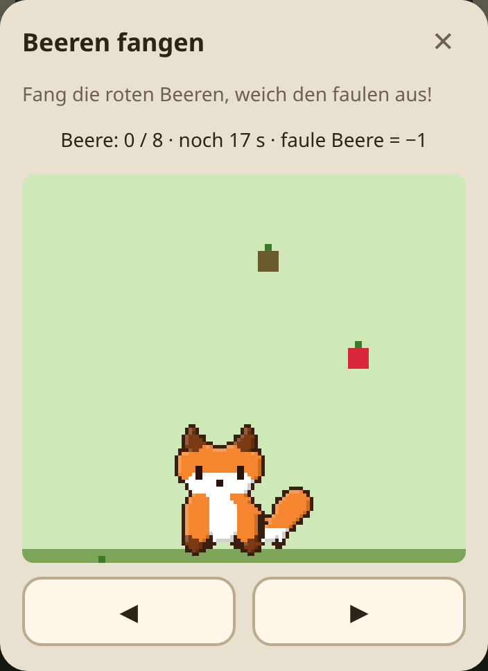
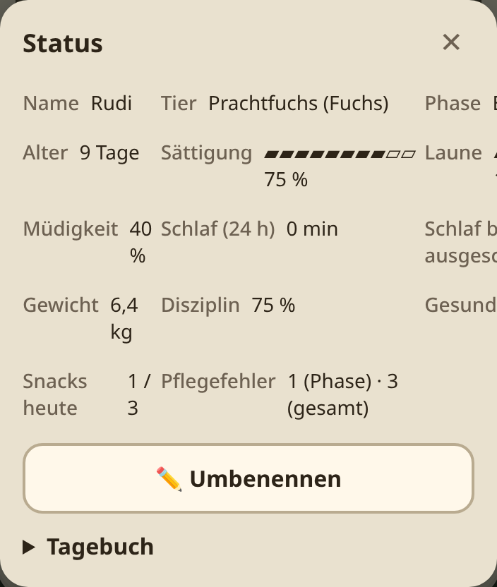

# Waldling – virtuelles Haustier

Ein virtuelles Haustier im Stil der 90er-Jahre-Taschenspiele, als Web-App, die sich auf Android installieren lässt. Man zieht einen **Fuchs**, einen **Igel**, eine **Katze** (mit zufälliger Fellfarbe und Muster) oder einen **Hund** (10 Rassen, zufällige Farbe und Muster) vom Ei bis zum Erwachsenen groß: füttern, schlafen legen, sauber machen, spielen, erziehen und gesund pflegen. Alles läuft in Echtzeit und geht auch weiter, wenn die App zu ist.

**▶ Jetzt spielen: https://spikepy.github.io/tamagotchi/**

<p align="center">
  
  
  
</p>

<p align="center">
  
  
  
</p>

<p align="center">
  
  
  
</p>

<p align="center">
  
</p>

## Features

- **Lebenszyklus:** Ei (1 min) → Baby (1 Tag) → Kind (5 Tage) → Teenager (5 Tage) → Erwachsen. Welche Form das Tier annimmt, hängt von Pflegefehlern und Disziplin ab. Am Lebensende zieht es sich in den Wald zurück.
- **Bedürfnisse:** Sättigung und Laune (HUD-Leisten mit je 4 Segmenten), Müdigkeit, Gewicht, Disziplin und Gesundheit.
- **Schlafen:** Das Tier wacht nach insgesamt 8 Stunden Schlaf automatisch auf. Danach hat es Hunger und kackt innerhalb einer Stunde.
- **Hygiene:** Es kackt alle 1–3 Stunden. Liegt ein Haufen länger als 4 Stunden, wird es krank.
- **Mehrere Tiere:** bis zu 4 gleichzeitig, Umschalter oben
- **Umgebung:** Fuchs am Waldrand mit Baumhöhle, Igel im Garten mit Laubhaufen, Katze im Zimmer mit Körbchen und Kratzbaum
- **Hunde:** 10 Rassen (Labrador, Schäferhund, Dackel, Mops, Husky, Beagle, Dalmatiner, Pudel, Border Collie, Corgi), zufällig mit passender Farbe und Muster
- **Katzen-Fell:** 6 Fellfarben × 4 Muster (einfarbig, getigert, gefleckt, weiße Pfoten), zufällig pro Tier.
- **5 Minispiele pro Tier:** zum Beispiel Mäusesprung, Links oder rechts?, Beeren fangen, Stöckchen holen und Spuren lesen.
- **Rufen:** Braucht das Tier etwas, ruft es mit Ton und Benachrichtigung. Reagiert man nicht innerhalb von 15 Minuten, zählt das als Pflegefehler.
- **Offline und installierbar (PWA):** Der Spielstand liegt nur lokal im Browser (localStorage).

Alle Regeln stehen in der **[SPEC.md](SPEC.md)**.

### URL-Parameter zum Testen

Setzen Werte des gerade angezeigten Tiers, z. B. https://spikepy.github.io/tamagotchi/?happy=4&hunger=4&sick=0

`happy=0–4` · `hunger=0–4` · `sick=1|0` · `tired=0–100` · `sleep=1|0`

## Entwicklung

```bash
npm install
npm run dev        # Dev-Server (auch im LAN erreichbar, z. B. vom Handy)
npm test           # Tests der Spiellogik
npm run build      # Produktions-Build nach dist/
npm run preview    # Build lokal ausliefern
```

Weitere Skripte:

```bash
npm run icons        # App-Icons aus dem Fuchs-Sprite neu erzeugen
npm run screenshots  # README-Screenshots neu erzeugen (braucht laufendes "npm run preview" und Chromium)
```

## Auf Android installieren

1. https://spikepy.github.io/tamagotchi/ in Chrome auf Android öffnen.
2. Im Menü **„App installieren“** bzw. **„Zum Startbildschirm hinzufügen“** wählen. Alternativ gibt es in der App unter **⚙️ Mehr** einen Knopf **„Als App installieren“**.

Danach startet die App mit eigenem Icon im Vollbild und funktioniert auch offline.

> Hinweis: Benachrichtigungen kommen nur, solange die App im Hintergrund noch läuft. Echte Push-Nachrichten bei komplett geschlossener App bräuchten einen Server.

## Deployment

Bei jedem Push auf `main` testet und baut der GitHub-Actions-Workflow `.github/workflows/pages.yml` die App und veröffentlicht sie auf GitHub Pages.

## Aufbau

```
src/
  engine/    Spiellogik ohne UI: Zustand, Minuten-Simulation, Aktionen, Regeln (config.ts), Tests
  species/   Tierarten als reine Daten: Pixel-Sprites, Farben, Namen, Minispiel-Themen
  render/    Pixel-Renderer für den Bildschirm (Canvas)
  ui/        Oberfläche, Dialoge, Minispiele
public/      Manifest, Service Worker, Icons
```

**Neue Tierart:** In `src/species/` eine neue `SpeciesDef` anlegen und in `src/species/index.ts` eintragen. An der Spiellogik muss dafür nichts geändert werden.

**Balancing:** Alle Zeiten und Werte stehen in `src/engine/config.ts`.
